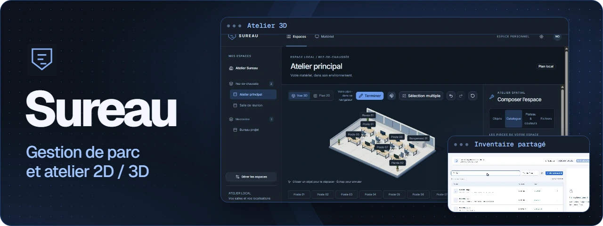
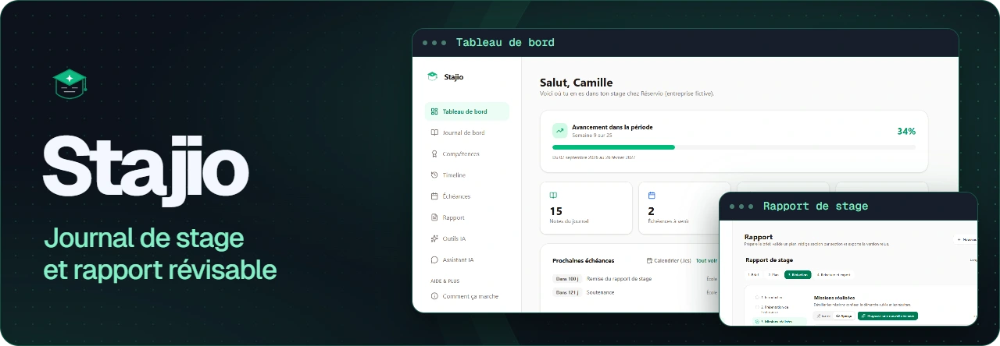

  

  <h1>Nadjide Omar</h1>

  

  

    <samp>Je conçois des applications utiles, sécurisées et reproductibles, de l’interface à la production.</samp>
     
    Français natif · Anglais C1
  

  

    
    
    
  

---

## Projets à découvrir

Une application libre et auto-hébergée pour gérer un parc informatique et retrouver chaque équipement sur le plan 2D ou 3D des locaux.

**Java · Spring Boot · React · Three.js · PostgreSQL · Docker Compose**\
[Vidéo de Sureau](https://portfolio-ts-nine.vercel.app/?project=sureau) · [Code source](https://github.com/Nadjide/sureau)

Un journal de stage et d’alternance pour suivre ses compétences et préparer un rapport révisable. L’IA locale via Ollama reste facultative.

**Next.js · TypeScript · SQLite · Ollama · Docker Compose**\
[Vidéo de Stajio](https://portfolio-ts-nine.vercel.app/?project=stajio) · [Code source](https://github.com/Nadjide/stajio)

Un laboratoire interactif pour diagnostiquer une API, exécuter un pipeline et revenir à une version saine, en simulation ou avec Docker en local.

**React · Node.js · Docker · GitHub Actions**\
[Fiche et captures](https://portfolio-ts-nine.vercel.app/?project=devops-playground) · [Code source](https://github.com/Nadjide/devops-playground)

### Pokito

Backend de jeu multijoueur en temps réel. Le serveur autoritaire gère la logique de partie et s’appuie sur Supabase pour la persistance.

**Node.js · Socket.IO · Supabase · Docker**\
[Fiche de Pokito](https://portfolio-ts-nine.vercel.app/?project=pokito) · [Code de l’API](https://github.com/Pokito-ynov/api-pokito)

<strong>Autres explorations (Mobile, IA & MVP)</strong>

 

| Projet | Ce que j’y explore | Technologies |
| :--- | :--- | :--- |
| **Camarade** | MVP de plateforme étudiante, parcours utilisateur et logique full stack |    |
| **Smart Hire** | Questionnaires IA et visualisation des évaluations pour le recrutement |    |
| **Exploree** | Découverte de restaurants et d’activités à travers un flux de vidéos courtes |    |

---

## Du code à la production

**Software Engineer à forte culture DevOps**, je développe des applications full stack et j’accompagne l'intégralité de leur cycle de vie : conception, développement, tests, sécurisation et livraison.

Mon fil conducteur : comprendre le besoin, construire une solution lisible et la faire fonctionner en conditions réelles. Je m’intéresse particulièrement à **l’IA auto-hébergée** pour intégrer des fonctionnalités métier utiles tout en conservant la maîtrise des données.

<table width="100%">
  <tr>
    <td width="33%" align="center">
      <h3><samp>5 ans</samp></h3>
      <b>Expérience en entreprise</b> Conception et maintien de solutions métier
    </td>
    <td width="33%" align="center">
      <h3><samp>6 apps</samp></h3>
      <b>Applications en production</b> Déployées et exploitées en conditions réelles
    </td>
    <td width="34%" align="center">
      <h3><samp>−83 %</samp></h3>
      <b>Résultat concret</b> Temps d’évaluation qualité réduit de 30 à 5 min
    </td>
  </tr>
</table>

<table width="100%">
  <tr>
    <td width="50%" valign="top">
      <samp>01 // FULL STACK</samp>
      <h4>Produits de bout en bout</h4>
      Interfaces web réactives, API performantes, modélisation des données et logique métier.
    </td>
    <td width="50%" valign="top">
      <samp>02 // SÉCURITÉ & QUALITÉ</samp>
      <h4>Applications fiabilisées</h4>
      Authentification centralisée (SSO), contrôle d’accès (RBAC) et tests automatisés.
    </td>
  </tr>
  <tr>
    <td width="50%" valign="top">
      <samp>03 // IA AUTO-HÉBERGÉE</samp>
      <h4>Intégrations IA locales</h4>
      Orchestration d'API Python avec Ollama et Mistral auto-hébergés pour la souveraineté des données.
    </td>
    <td width="50%" valign="top">
      <samp>04 // INFRASTRUCTURE & RUN</samp>
      <h4>Livraison reproductible</h4>
      Conteneurisation Docker, pipelines CI/CD GitHub Actions et exploitation sur serveurs Linux et Windows.
    </td>
  </tr>
</table>

---

## Stack technique

### Pratiquée en entreprise

| Domaine | Technologies |
| :--- | :--- |
| **Frontend** |      |
| **Backend & API** |       |
| **Données & IA** |          |
| **Qualité** |      |
| **DevOps** |       |

### Explorée sur projets

  
  
  
  
  
  
  
  
  
  
  

**En préparation :** Certification AWS Cloud Practitioner.

<strong>Activité GitHub</strong>

 

  
  

---

### Construisons la suite

<samp>Une équipe à rejoindre, une application à faire évoluer ou un projet à lancer ?</samp> 
Je suis ouvert aux opportunités et aux collaborations.

  

