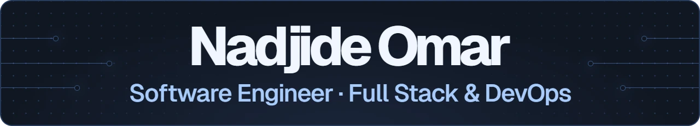
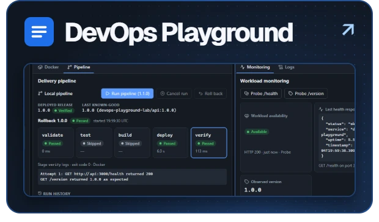

  <picture>
    <source media="(prefers-color-scheme: dark)" srcset="assets/profil-dark.webp">
    <source media="(prefers-color-scheme: light)" srcset="assets/profil-light.webp">
    
  </picture>

  5 ans en entreprise · 6 apps en production 
  <a href="https://portfolio-ts-nine.vercel.app/">Portfolio</a> ·
  <a href="https://www.linkedin.com/in/nadjide-omar">LinkedIn</a> ·
  <a href="mailto:nadjide.omar@outlook.fr">Contact</a>

<h2 align="center">Projets</h2>

  
  
  

  <strong>Code source</strong> ·
  <a href="https://github.com/Nadjide/sureau">Sureau</a> ·
  <a href="https://github.com/Nadjide/stajio">Stajio</a> ·
  <a href="https://github.com/Nadjide/devops-playground">DevOps Playground</a>

